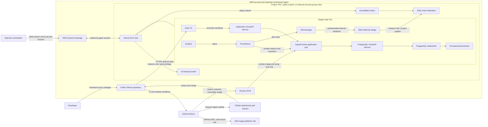
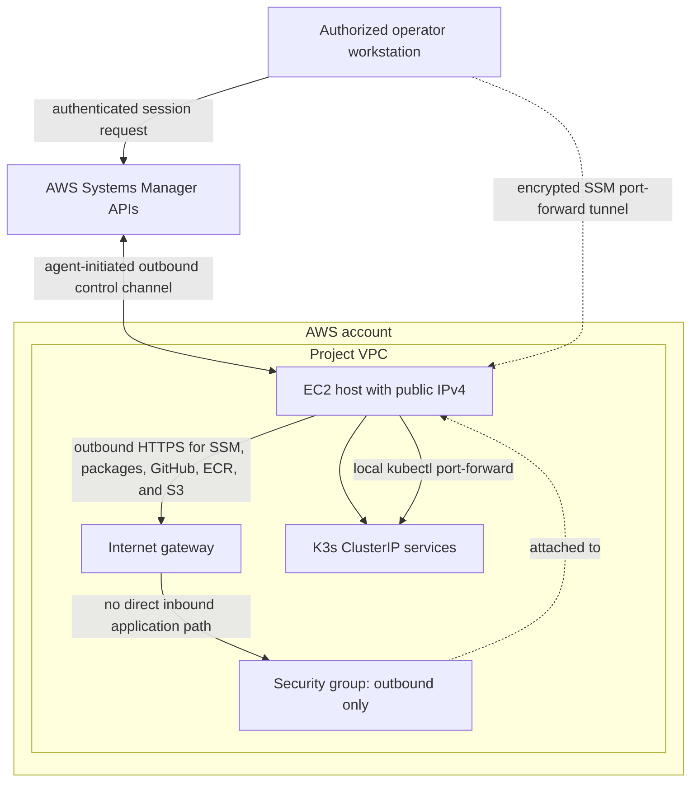
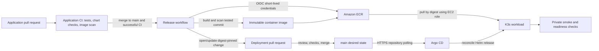
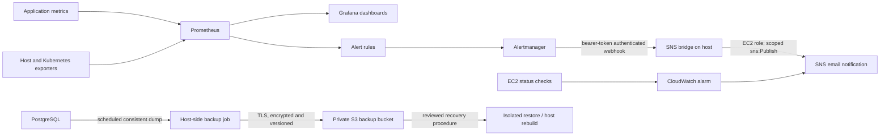

# Architecture and flows

[Project overview](../README.md) | [Deployment guide](../prerequisites/README.md)

These diagrams describe the current repository configuration. They are not a claim that an AWS environment is presently deployed.

## Platform components and trust boundaries



## Network and administration flow



The EC2 public address supports outbound connectivity; it does not create a public application endpoint. Do not add inbound rules, NodePorts, or public load balancers to bypass the documented private access path.

## User request path

```mermaid
sequenceDiagram
    actor User as Authorized operator
    participant Browser as Browser on workstation
    participant SSM as Systems Manager tunnel
    participant Host as EC2 / K3s host
    participant Service as Application ClusterIP Service
    participant App as Application pod
    participant DBService as PostgreSQL ClusterIP Service
    participant DB as PostgreSQL pod and persistent volume

    User->>SSM: Start authenticated port-forward session
    User->>Browser: Open the local forwarded URL
    Browser->>SSM: HTTP request through local tunnel
    SSM->>Host: Forward connection; no public ingress
    Host->>Service: kubectl port-forward to application service
    Service->>App: Route request to ready application pod
    App->>DBService: Execute parameterized SQL query
    DBService->>DB: Route to PostgreSQL
    DB-->>App: Return ticket/comment data
    App-->>Browser: JSON API response or UI assets
```

The application and database Kubernetes Services are `ClusterIP`. The browser UI and API are available only through the operator's private forwarding session in this baseline.

## CI, image release, and GitOps



Application CI for pull requests does not receive AWS credentials. GitHub Actions publishes artifacts through a repository- and branch-scoped OIDC role; Argo CD is the only component that reconciles Kubernetes desired state.

## Monitoring, notifications, and backups



In-cluster monitoring cannot report failure of its only host; the separate CloudWatch status alarm is an independent host signal. Backups and recovery restore application data, not uncommitted changes or secrets.
